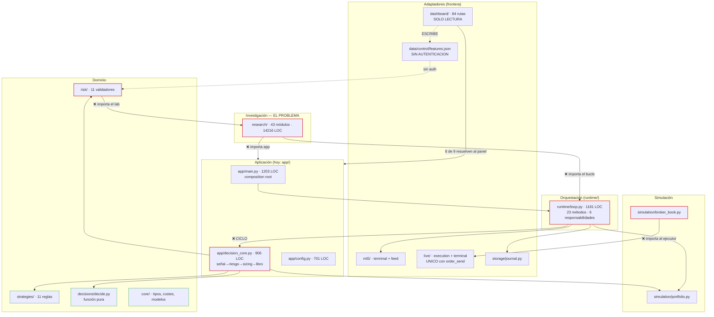
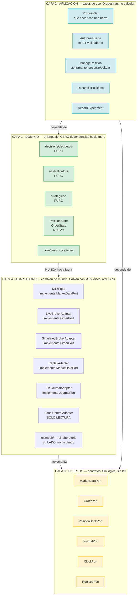
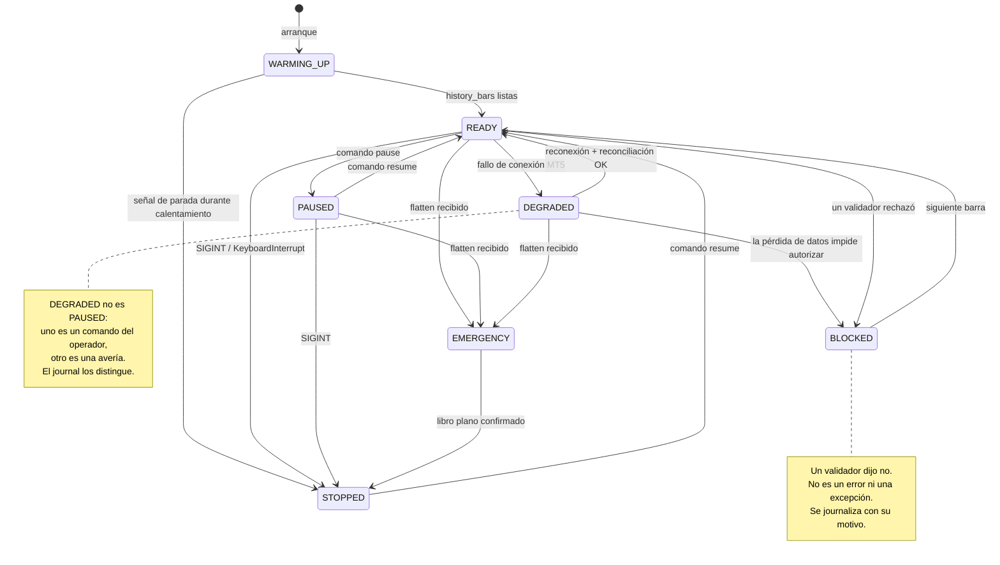

# GTS — Propuesta de reestructuración arquitectónica

**Fecha:** 2026-10-10 · **Base:** `e801d4e` + trabajo sin commitear
**Modo:** propuesta. No se ha modificado ninguna línea de producción.
**Base de la propuesta:** el mapa maestro de `project-control/` (auditoría del
2026-10-10) más un análisis de imports con AST ejecutado sobre los 119 módulos
del árbol.

---

## 0. Resumen ejecutivo

**El sistema tiene un problema de estructura, no de lógica.**

Las vallas, los validadores, el Reality Check, la cadena de hash y la reconciliación
están escritos con más rigor del habitual. Lo que falta es una frontera explícita
entre lo que **mide** el sistema y lo que **opera** con él, y esa ausencia produce
consecuencias concretas y medidas:

| Consecuencia medida | Dónde |
|---|---|
| El bucle de trading importa el módulo de investigación | `research.replay_runner → runtime.loop` |
| El motor de riesgo importa el módulo de investigación | `risk.portfolio_optimizer → research.io_arctic` |
| El simulador importa el ejecutor real | `simulation.broker_book → live.execution` |
| Hay un ciclo duro entre raíz y bucle | `runtime.loop → app.decision_core` |
| 66 líneas de código muerto que duplican la lógica de ejecutar una operación | `runtime/loop.py:916-981`, inalcanzable |
| El panel llama a un módulo que el panel no tiene | `dashboard/app/main.py:1861, 1946` → `ModuleNotFoundError` siempre |
| No hay protocolo común de identidad de experimento | `barrido`, `confirmación` y `walk-forward` sólo comparten `timeframe` |

**La tesis de la propuesta:** el sistema no necesita más validators ni más tests.
Necesita **puertos** — interfaces en las que se apoya el caso de uso— para que
"investigación", "decisión", "riesgo", "ejecución" y "observabilidad" dejen de
importarse entre sí.

**Lo que NO se propone:** microservicios, event sourcing, reescritura, ni tocar
la lógica de trading. El monolito modular se mantiene.

---

## 1. Diagnóstico arquitectónico

### 1.1 El grafo real de importaciones

Medido con AST sobre 119 ficheros, agrupado por capa. `A → B` es el número de
aristas distintas que importan de B.

| Origen | Destino | Aristas | ¿Correcto? |
|---|---|---|---|
| `core` | *nada fuera de core* | **0** | ✅ **La única capa limpia del sistema** |
| `app` | `runtime` | 5 | ⚠️ permite, pero `runtime→app` rompe el sentido |
| `app` | `research` | **6** | ❌ la raíz depende del instrumento |
| `app` | `backtest`/`live` | 2 | ⚠️ la raíz debe conocer el adaptador, correcto |
| **`runtime`** | **`app`** | **1** | ❌ **ciclo duro** `runtime.loop → app.decision_core` |
| **`research`** | **`runtime`** | **1** | ❌ **ciclo duro** `research.replay_runner → runtime.loop` |
| **`research`** | **`app`** | **1** | ❌ tercer ciclo: `research.baseline → app.models` |
| **`risk`** | **`research`** | **1** | ❌ **el motor de riesgo depende del laboratorio** |
| **`simulation`** | **`live`** | **1** | ❌ el simulador depende del ejecutor real |
| `dashboard` | `core`,`research`,`strategies` | 11 | ⚠️ ver §1.3 |
| `decisions`,`strategies`,`indicators`,`mt5` | `core` | 13 | ✅ dominio sobre núcleo |

**Cuatro violaciones estructurales** (`runtime→app`, `research→runtime`,
`research→app`, `risk→research`) y **una inverted** (`simulation→live`).

### 1.2 Las tres consequences de esas violaciones

**a) La prueba de la conformidad de costes es circular.**
`test_cost_conformity.py` compara backtest contra simulación. Pero `simulation`
importa `live`, y `risk` importa `research`: el módulo que sirve de referencia
hereda parte de lo que debería estar comprobando. Por eso ese test
**calcula el bruto a mano y no ejecuta ninguno de los dos motores**
(`ISS-005` en `ISSUES.yaml`).

**b) El backtest no es una simulación del bot, es un calco.**
`research/replay_runner.py` reconstruye el bucle importándolo (`runtime.loop`).
Cuando el bucle cambia, el backtest cambia con él, y una regresión en el bucle se
manifiesta como un "nuevo resultado" en lugar de como un fallo. Ése es el
origen de la fuga temporal que el `TradeTape` tuvo que cazar (`b2fc271`).

**c) Un fallo en `research` puede romper el bot.**
`risk.portfolio_optimizer` importa `research.io_arctic` **en el interior de dos
funciones** (líneas 319 y 500), no en el import de módulo. Si Arctic no está
disponible —y no lo está en un despliegue normal— el optimizador revienta
*después* de arrancar, no al importar.

### 1.3 El caso de `dashboard`: D-017 se cumple con una excepción real

La afirmación documentada (D-017: *"the panel does not import the bot"*) necesita
precisión. Medido ejecutando el intérprete real del panel:

```
sys.path.insert(0, dashboard_dir)   # dashboard/app/main.py:56

resolves 'app' to: dashboard/app/__init__.py
  app.config      -> dashboard/app/config.py      ✓ el panel
  app.schemas     -> dashboard/app/schemas.py     ✓ el panel
  app.mt5_engine  -> dashboard/app/mt5_engine.py  ✓ el panel
  app.inference   -> dashboard/app/inference.py   ✓ el panel
  app.learning    -> ModuleNotFoundError          ✗ ROTO
```

De las 9 aristas `dashboard → app`, **8 resuelven al panel** por el `sys.path`.
Una no: `from app.learning import LearningLoop` (líneas 1861 y 1946).

> **Defecto confirmado (nuevo).** Los endpoints `GET /api/learning/report` y
> `POST /api/learning/run` fallan **siempre** con `ModuleNotFoundError`. El panel
> no tiene `learning.py`; el bot sí. Bajo D-017 esa importación no debería existir.
> No está en `ISSUES.yaml` porque se descubrió en esta propuesta.

### 1.4 Concentración de responsabilidades (medida)

| Fichero | LOC | Problema |
|---|---|---|
| `runtime/loop.py` | 1 181 | 23 métodos; orchestración, comandos, conexión, riesgo, sizing, ejecucion, heartbeat, journal |
| `app/decision_core.py` | 906 | resolución de señal, riesgo, sizing, predicción, portfolio optimizer |
| `app/main.py` | 1 203 | composition root + CLI + preflight + doctor |

`runtime/loop.py` mezcla seis responsabilidades distinguibles. Y **contiene una
definición muerta**: `_act` aparece dos veces (líneas 916 y 1064); Python conserva
la última, así que **las líneas 916–981 son inalcanzables**. Medido: 11 de sus 12
sentencias son idénticas a la versión viva, 66 líneas de código que nobody ejecuta
y que duplican la lógica de ejecutar una operación —justo lo que un programador
modificaría creyendo que es la que corre.

---

## 2. Arquitectura actual vs. propuesta

### 2.1 Diagrama — arquitectura actual (medida)



### 2.2 Diagrama — arquitectura propuesta

Cuatro capas, una regla: **las dependencias solo apuntan hacia dentro.**



**La diferencia con el diagrama actual:** en el de ahora, `risk` importa
`research` y `simulation` importa `live`. En el propuesto, ambos dependen de un
**puerto** (L3), y `research` es un adaptador más — uno que además es *tests*.

> Nota: la flecha `L1 -.-> L4` con guion y "NUNCA" indica una dependencia
> **prohibida**. Es la valla que se implementará como test (§7).

---

## 3. Tabla de responsabilidades y contratos

### 3.1 Qué es dominio y qué no

| Módulo | ¿Dominio? | Razón |
|---|---|---|
| `decisions/decide.py` | **Sí** | Función pura: señal + posición → acción. Cero I/O. Ya es un ejemplo a seguir. |
| `risk/validators.py` | **Sí** | 11 funciones puras `(valor, límite) → (bool, str)`. |
| `strategies/*` | **Sí** | Producen −1/0/+1 sin ver la cuenta. |
| `core/types.py`, `core/costs.py` | **Sí** | Vocabulario y aritmética. `core` ya tiene **0 dependencias hacia fuera**: es el modelo a seguir. |
| `runtime/loop.py` | No | Orquesta: lee reloj, llama a otros, escribe journal. |
| `app/decision_core.py` | No | Orquesta: resuelve señal → pide permiso → dimensiona → ejecuta. |
| `research/*` | No | Es un laboratorio. Usa el dominio; el dominio no lo usa a él. |
| `live/*` | No | Adaptador de un sistema externo que hoy está apagado. |
| `simulation/*` | No | Adaptador de un mundo simulado. **No debería conocer al real.** |

### 3.2 Contratos por caso de uso

| Caso de uso | Puerto de entrada | Puerto de salida | Dominio que usa | Autoriza | Quién lo invoca |
|---|---|---|---|---|---|
| **ProcessBar** | `MarketDataPort.pull()` | `JournalPort.append()` | `decide`, `strategies` | — | `runtime` (el bucle) |
| **AuthorizeTrade** | `PositionBookPort.state()`, `ClockPort.now()` | `JournalPort.append()` | `risk.validators` (11) | **Único** | `ProcessBar` |
| **SizePosition** | `AuthorizeTrade.result`, `MarketDataPort.atr()` | — | `core.costs` | — | `ProcessBar` |
| **ManagePosition** | `decide.action` | `OrderPort.submit()`, `JournalPort.append()` | `decide` | ya autorizado | `ProcessBar` |
| **ReconcilePositions** | `OrderPort.open_positions()` | `JournalPort.append()` | — | — | `runtime` (arranque **y** cada N barras) |
| **RecordExperiment** | `RegistryPort` | `RegistryPort` | `research.criterio` | — | laboratorio |

### 3.3 Los seis puertos

```python
# Solo la FORMA. La implementación va en la Fase 2.
class MarketDataPort(Protocol):
    def pull(self, symbol: str, timeframe: str) -> Bar: ...
    def atr(self, symbol: str, timeframe: str, period: int) -> float | None: ...

class OrderPort(Protocol):
    """La frontera ÚNICA por la que una orden puede salir."""
    def submit(self, intent: OrderIntent) -> OrderAck: ...
    def cancel(self, ticket: int) -> OrderAck: ...
    def open_positions(self) -> Sequence[PositionSnapshot]: ...
    def working_orders(self) -> Sequence[OrderSnapshot]: ...

class PositionBookPort(Protocol):
    """El libro. Simulado y real lo implementan; el caso de uso no distingue."""
    def apply(self, action: Action, size: float, fill: Fill) -> PositionSnapshot: ...
    def position(self, symbol: str) -> PositionSnapshot | None: ...

class JournalPort(Protocol):
    def append(self, entry: DecisionEntry) -> int: ...
    def verify_chain(self, from_index: int = 0) -> bool: ...

class ClockPort(Protocol):
    """Existe para que la hora de pared NUNCA entre en un replay."""
    def now(self) -> float: ...
    def bar_close(self, symbol: str, timeframe: str) -> int: ...

class RegistryPort(Protocol):
    def confirmed_evidence(self) -> list[Evidence]: ...
    def mark_tram_spent(self, tramo: str, motivo: str) -> None: ...
```

**Por qué `ClockPort` importa:** el bug `b2fc271` (un reloj de pared dentro de
`loop._check_exits`, `int(time.time())` como `bar_close_time`) fue exactamente
"hora real mezclada con tiempo de barras". Un puerto no lo impide, pero lo hace
**visible en la firma**.

---

## 4. Perfiles de ejecución y políticas de riesgo

### 4.1 Los seis perfiles

| Perfil | Datos | Cuenta | ¿Envía órdenes? | Valida riesgo | Journal | Para qué |
|---|---|---|---|---|---|---|
| **RESEARCH** | CSV | ninguna | **NO** | OFF | no | Barridos, etiquetas, hipótesis |
| **BACKTEST** | CSV | ninguna | **NO** | OFF | no | Walk-forward, paridad |
| **PAPER** | MT5 real | ninguna | **NO** | **ON** | **sí** | Simulación con precios vivos |
| **SHADOW** | MT5 real | **demo** | **NO** | **ON** | **sí** | Señal en mercado sin enviar |
| **DEMO** | MT9 demo | demo | **SÍ** | **ON** | **sí** | Única prueba del ejecutor real |
| **LIVE** | MT5 real | **fondada** | **SÍ** | **ON** | **sí** | Operación con dinero |

**Idea central:** `SHADOW` es el perfil que **falta** y es el más valioso. Opera
con datos reales y con una cuenta real, pero **nunca envía**. Permite validar el
camino completo —precios, sizing, riesgo, journal, reconciliación— sin que exista
una orden. Es la diferencia entre "creemos que funciona" y "lo hemos visto
funcionar".

### 4.2 Matriz de compatibilidad perfil × política

| | `ENFORCE` | `OBSERVE` | `BYPASS` |
|---|---|---|---|
| **RESEARCH** | ⚪ irrelevante | ⚪ irrelevante | ⚪ irrelevante (no opera) |
| **BACKTEST** | ⚪ irrelevante | ⚪ irrelevante | ⚪ irrelevante (no opera) |
| **PAPER** | ✅ normal | ✅ **permitido**¹ | 🚫 **prohibido** |
| **SHADOW** | ✅ normal | ✅ **permitido**¹ | 🚫 **prohibido** |
| **DEMO** | ✅ **obligatorio** | 🚫 **prohibido** | 🚫 **prohibido** |
| **LIVE** | ✅ **obligatorio** | 🚫 **prohibido** | 🚫 **prohibido** |

¹ En PAPER y SHADOW, `OBSERVE` permite registrar **qué habría rechazado** el
riesgo sin bloquear. Es el modo de diagnóstico ("¿por qué no me opera?") y es
seguro porque **ninguno de los dos perfiles puede enviar órdenes**.

### 4.3 La invariante que el encargo exige, y cómo se hace real

> *"OBSERVE y BYPASS no pueden desactivar las protecciones obligatorias de
> ningún modo con acceso a envío de órdenes."*

Esto no se implementa con un `if` en el arranque. Se implementa con el **tipo**:

```python
# ports/profiles.py — LA REGLA, EN EL SISTEMA DE TIPOS
class SendCapable(Protocol):
    """Solo DEMO y LIVE lo satisfacen. La capacidad de enviar es un tipo."""

class NoSend(Protocol):
    """RESEARCH, BACKTEST, PAPER, SHADOW."""

def validar_arranque(config) -> None:
    match config.perfil:
        case "RESEARCH" | "BACKTEST":
            assert not config.puede_enviar()
        case "PAPER" | "SHADOW":
            assert not config.puede_enviar(), "SHADOW no envia NUNCA"
            # OBSERVE permitido aquí: no hay a qué burbujeizar, porque no hay envío
        case "DEMO" | "LIVE":
            assert config.puede_enviar(), "perfil que envia, sin capacidad de envio"
            assert config.politica == "ENFORCE", (
                f"{config.perfil} exige ENFORCE; {config.politica} lo desarmaria"
            )
```

La regla que lo hace a prueba de discharging accidental:

> **Un perfil con capacidad de envío exige `ENFORCE` en la firma del tipo, no en
> una comprobación en runtime.**

Si alguien define un perfil nuevo, el compilador le exige declarar su relación con
el envío. No es "una validación que se puede saltar"; es una regla que hay que
escribir para poder seguir.

### 4.4 El fallo que esto cierra

Hoy, `POST /api/features` (`dashboard/app/main.py:2118`) escribe
`features.json` sin autenticación ni CSRF, y ese fichero se traduce a los límites
que lee `risk/engine.py`. El panel **no puede colocar órdenes** (D-015, verificado)
pero **sí puede desactivar los once validadores**.

Con perfiles, esto se cierra por construcción:

```
PAPER/SHADOW → el panel NO puede cambiar límites (no es su perfil)
DEMO/LIVE    → cambiar límites exige un commit, no un POST
```

**Recomendación:** los interruptores de riesgo salen del alcance del panel por
defecto, y solo se habilitan con un flag explícito de `OBSERVE` en un perfil sin
envío. Es `R-002` en el roadmap, resuelto por diseño en vez de por vigilancia.

---

## 5. Ciclo de vida y máquina de estados

### 5.1 Secuencia de una barra

```
   ┌──────────┐
   │ 1. BARRA │  MT5Feed.pull() → barra CERRADA (start_pos=1, no la que se forma)
   └────┬─────┘
        ▼
   ┌────────────────┐  ¿history_bars suficientes?
   │ 2. WARMING_UP  │──── no ─────────────────────┐
   └────┬───────────┘                              │
        │ sí                                        │
        ▼                                           │
   ┌──────────────┐  comando pause ──┐               │
   │ 3. PAUSED    │◄────────────────┤               │
   └────┬─────────┘                 │               │
        │ sin pausa                 │               │
        ▼                           │               │
   ┌──────────────┐                 │               │
   │ 4. ESTRATEGIA│  → −1 / 0 / +1  │               │
   └────┬─────────┘                 │               │
        ▼                           │               │
   ┌──────────────┐  tabla de transicion PURA       │
   │ 5. DECIDIR   │  decide(signal, position) →     │
   │   (PURA)     │  hold|open_long|open_short|     │
   │              │  close|flip_long|flip_short      │
   └────┬─────────┘  ← NO ve la cuenta, NO ve riesgo│
        ▼                                           │
   ┌──────────────┐                                 │
   │ 6. SIZING    │  risk/sizer.py: ATR, stop,      │
   |              |  volumen. Sin un máximo aquí  |
   └────┬─────────┘                                 │
        ▼                                           │
   ┌──────────────────────────────────────┐         │
   │ 7. AUTORIZAR — LOS 11 VALIDADORES   │         │
   │   spread · volatility · session ·    │         │
   │   drawdown · day_loss · max_open ·    │         │
   │   per_symbol · margin · min_sl ·     │         │
   │   trade_count · consecutive_losses   │         │
   └────┬─────────────────────────────────┘         │
        │                                           │
   ┌────┴─────┐                                    │
   │ ENFORCE  │── rejected ──► journal(fail_reason=  │
   └────┬─────┘                RISK_REJECTED) ──► PAUSED? no ─► espera
        │ autorizado                                   │
        ▼                                               │
   ┌──────────────┐                                    │
   │ 8. EJECUTAR  │  OrderPort.submit(intent)           │
   └────┬─────────┘                                    │
        ▼                                               │
   ┌──────────────┐  ┌──────────────────────┐          │
   │ 9a. LIBRO    │  │ 9b. BROKER (real)    │          │
   │  SIMULADO    │  │  solo DEMO/LIVE      │          │
   │  fill=precio │  │  fill=mercado        │          │
   └────┬─────────┘  └──────────┬───────────┘          │
        │                      │                      │
        └──────────┬───────────┘                      │
                   ▼                                  │
   ┌──────────────────────────────────────┐           │
   │ 10. CHECK_EXITS (cada barra)         │           │
   │    SL/TP por precio, con hueco       │◄──────────┘
   │    tratado a mercado                 │
   └────┬─────────────────────────────────┘
        │ ¿se cerró?
        ▼ sí
   ┌──────────────┐
   │ 11. JOURNAL  │  entrada encadenada por hash
   │              │  + heartbeat a state.json
   └────┬─────────┘
        │
        └──► vuelve a 1
```

### 5.2 Máquina de estados del bot



**Invariantes de la máquina** (los que hay que testear, no los que hay que
documentar):

1. `WARMING_UP` nunca opera. Una barra no se evalúa hasta tener histórico.
2. `PAUSED` y `DEGRADED` se distinguen en el journal: uno es decisión del
   operador, el otro es avería.
3. `BLOCKED` ≠ `DEGRADED`. Un validador que rechaza no es una avería.
4. `EMERGENCY` sólo se sale por `STOPPED`, y sólo con el libro confirmado plano.
5. Ninguna transición ocurre sin un journal. **Ninguna.**

### 5.3 Ciclo de vida de una operación

| Estado | Quién lo produce | Qué significa | Qué pasa si falla |
|---|---|---|---|
| `INTENT` | Sizing | Decidido abrir, aún no enviado | No existe fuera del proceso |
| `PENDING` | `OrderPort.submit` | Enviada al broker, sin fill todavía | **Reintentar es peligroso: puede duplicar** |
| `PARTIAL` | Broker | Fill parcial | **El libro simulado NO lo modela** (ver abajo) |
| `FILLED` | Broker | Fill completo | Se registra el coste real |
| `OPEN` | `ManagePosition` | En libro, con SL/TP | Se vigila cada barra |
| `CLOSED` | SL / TP / regla | Cerrada | Se registra PnL neto |
| `UNKNOWN` | `ReconcilePositions` | El bot no la reconoce | **El bot PARA** (no se reconcilia en silencio) |

**Cuatro huecos reales en este ciclo, medidos hoy:**

| Hueco | Evidencia | Consecuencia |
|---|---|---|
| **Orden pendiente** | `live/execution.py:367` tiene `pending()`. `simulation/portfolio.py` **no tiene ninguna referencia a órdenes pendientes** | El replay no puede reproducir un estado que el broker real sí produce |
| **Fill parcial** | `live/execution.py:78` define `DONE_PARTIAL`. El libro simulado no | Una simulación puede divergir del real sin que nada lo note |
| **Posición desconocida** | `compare()` la detecta, pero se llama **una vez**, en `main.py:606` | Una posición que aparece a mitad de sesión no se detecta |
| **Reconciliación recurrente** | Sólo existe `main.py:606` | El escenario que `reconcile.py` describe (doble posición tras reinicio) está cubierto al arrancar, no durante |

> El primero y el segundo son **asimetrías entre el replay y la ejecución real**.
> Es el punto donde "el backtest dice X" y "la cuenta hizo Y" divergen sin que
> ningún test lo note. La propuesta lo trata en la Fase 4, no antes, porque exige
> tocar `simulation/portfolio.py`.

---

## 6. Protocolo uniforme de experimento

### 6.1 El problema, medido

Comparando las claves de los tres tipos de artefacto:

| Clave | `barrido-*.json` | `confirmacion-*.json` | `walkforward.provenance` |
|---|---|---|---|
| `symbol` | ✅ | ✅ | ❌ (`symbols`, plural) |
| `timeframe` | ✅ | ✅ | ✅ |
| `n_trials` | ✅ | ❌ | ❌ |
| `git_commit` | ❌ | ❌ | ✅ |
| `sha256` del tramo | ✅ (`pin`) | ✅ (`pin`) | ❌ |
| `broker` | ❌ | ❌ | ✅ |
| `criterio` | ❌ | ✅ (`liston`) | ❌ |

**Único campo común a los tres: `timeframe`.** Y falta en **los tres**: un
identificador de experimento, una versión de esquema, y un timestamp.

Consecuencia concreta: **no se puede responder "¿estas tres piezas de evidencia
salieron de la misma corrida?"** Se puede responder por cada una, por separado.

### 6.2 El protocolo propuesto

Un único envoltorio, tres payload:

```python
# research/protocol.py  (Fase 2)
class SchemaVersion(IntEnum):
    V1 = 1

@dataclass(frozen=True)
class ExperimentId:
    """Identidad uniforme. Inmutable. Se imprime dentro del nombre del fichero."""
    simbolo: str
    timeframe: str
    tipo: Literal["barrido", "confirmacion", "walkforward"]
    tramo_id: str          # "entrenar-1" / "examinar-1"
    run_id: str            # timestamp UTC + hash del pin
    schema_version: SchemaVersion

@dataclass
class ArtifactEnvelope:
    """UN envoltorio. Los tres tipos de artefacto lo llevan."""
    id: ExperimentId
    git_commit: str | None
    data_sha256: dict[str, str]      # símbolo → hash del tramo
    broker: str | None
    timestamp: str
    payload: dict                     # lo específico del tipo
```

**Efecto:** `barrido-AUDUSD-H1-entrenar-1.json`, `confirmacion-*.json` y
`walkforward-*.json` se leen con **una** función, y la pregunta "¿salieron de la
misma corrida?" tiene respuesta mecánica.

**Y algo que hoy no se puede responder:** con `n_trials` ausente de la
confirmación, nadie sabe cuántas alternativas perdió el ganador que se está a
punto de promover.

---

## 7. Matriz de pruebas de aislamiento y seguridad

### 7.1 Aislamiento

| # | Prueba | Qué demuestra | Riesgo de falso positivo |
|---|---|---|---|
| **A1** | `test_dominio_no_importa_adaptadores` — AST sobre `core/`, `risk/`, `strategies/`, `decisions/`: cero imports fuera | El dominio no depende del mundo | Ninguno; ya pasa hoy |
| **A2** | `test_no_ciclos_entre_capas` — el analizador de esta propuesta, como test | No hay `runtime→app`, `research→runtime`, `research→app`, `risk→research` | Ninguno |
| **A3** | `test_adaptadores_no_se_conocen_entre_si` — `simulation` no importa `live` y viceversa | La línea entre simulado y real es real | Ninguno |
| **A4** | `test_basetemp_fuera_del_arbol` — el test falla si el temporal está dentro del repo | Nunca se repite el falso positivo de `test_research_cannot_trade.py` | Bajo: hay que ignorar el temp |
| **A5** | `test_bundle_no_contamina_syspath` — reproduce el caso de `ISS-001` | Un artefacto construido no puede envenenar la suite | **Alto**: hay que simular el `sys.path` de un subproceso |
| **A6** | `test_replay_no_usa_reloj_de_pared` — un `ClockPort` falso hace el replay determinista | El tiempo real no entra en la simulación | Ninguno |
| **A7** | `test_investigacion_no_llega_a_produccion` — `research/` no es importable desde `app/` ni desde `runtime/` | Un fallo del laboratorio no rompe el bot | **Alto**: `research.baseline → app.models` y `replay_runner → runtime.loop` lo violan **hoy** |

### 7.2 Seguridad

| # | Prueba | Qué demuestra |
|---|---|---|
| **S1** | `test_panel_no_tiene_ruta_de_orden` (existe) | D-015 se sostiene |
| **S2** | `test_panel_no_puede_escribir_limites_de_riesgo` — **nuevo** | El panel no desarma los 11 validadores. **Hoy falla.** |
| **S3** | `test_perfil_invalido_impide_arrancar` — **nuevo** | `DEMO + BYPASS` no arranca |
| **S4** | `test_observe_y_bypass_requieren_perfil_sin_envio` — **nuevo** | La invariante de §4.3 |
| **S5** | `test_perfil_declarado_coincide_con_live_enabled` — **nuevo** | Un YAML que dice `LIVE` con `live.enabled: false` es un error |
| **S6** | `test_journal_verifica_cadena_sobre_fichero_real` — `decisions.jsonl` está vacío (0 bytes) | La cadena funciona con datos, no sólo sintéticos |
| **S7** | `test_solo_un_modulo_puede_enviar` — invertir la lista de prohibidos: enumerar los que **sí** pueden y negar el resto | Hoy depende de una lista escrita a mano (`ISS-013`) |
| **S8** | `test_panel_no_importa_el_bot` — resolver los imports **en runtime**, no por lectura de AST | Hoy: 8 de 9 resuelven al panel; `app.learning` está roto |
| **S9** | `test_aprendizaje_no_rota_el_panel` — **nuevo** | `GET/POST /api/learning/*` devuelven 501, no 500 |

### 7.3 Qué se repite de la evidencia existente

El encargo pide no tirar la evidencia antigua sin justificarlo. Registro propuesto:

| Categoría | Qué entra | Ejemplo medido |
|---|---|---|
| **VERIFIED** | Reproducible hoy con el mismo código y commit | Suite del panel 411/411; `test_reality_check.py` (33) |
| **EXPLORATORY** | Corrió, es reproducible, pero no era una prueba | Los 3 barridos con p-valores (`ISS-009` los sitúa aquí) |
| **SUPERSEDED** | Reemplazada por algo mejor; se conserva el valor | `walkforward_results_salvaged.json` sin procedencia, superado por los `archive/20261010` |
| **CONTAMINATED** | Corrió con un defecto conocido | Los folds marcados `out_of_sample` que eran validación (`ISS-002`) |
| **UNKNOWN** | No se sabe si sigue siendo reproducible | `walkforward_results.json` (363 MB, nunca cargado) |

**Aplicado a la evidencia que ya existe:**

| Artefacto | Categoría | Razón |
|---|---|---|
| `barrido-AUDUSD-H1-entrenar-{1,2}.json` | **EXPLORATORY** | p = 0,6988 / 0,9980. Reproducibles; el resultado es negativo y sigue siendo válido |
| `confirmacion-AUDUSD-H4-examinar-1.json` | **EXPLORATORY** | Refutada con t = −0,488 y beneficio negativo. Válida como refutación |
| `walkforward-H1-modelo-*-20261010.json` | **CONTAMINATED** | El propio fichero confiesa: los folds OOS no lo son para ese checkpoint (`ISS-002`) |
| `data/research/sweep-H4.json` | **UNKNOWN** | No existe y nunca se versionó. **No es evidencia: es una cita rota** |
| `checkpoints_training/best_model.pt` | **VERIFIED** | Carga; `model_manifest` lo declara |
| `data/journal/decisions.jsonl` | **UNKNOWN** | 0 bytes; nunca se ha verificado la cadena contra datos reales |

---

## 8. Nueva estructura de carpetas

### 8.1 Correspondencia actual → futuro

```
gts/
├── domain/                          ◄── NUEVO: lo que ya es puro, movido
│   ├── types.py         ◄── core/types.py
│   ├── models.py        ◄── core/models.py
│   ├── costs.py         ◄── core/costs.py
│   ├── decisions/       ◄── decisions/decide.py
│   ├── validators/      ◄── risk/validators.py
│   └── strategies/      ◄── strategies/
│
├── ports/                           ◄── NUEVO: los contratos. SIN LÓGICA
│   ├── market_data.py     MarketDataPort, ClockPort
│   ├── orders.py          OrderPort, OrderIntent, OrderAck
│   ├── position_book.py   PositionBookPort
│   ├── journal.py         JournalPort
│   ├── registry.py        RegistryPort
│   └── profiles.py        ExecutionProfile, RiskPolicy, validar_arranque()
│
├── usecases/                       ◄── NUEVO: orquestación sin I/O
│   ├── process_bar.py     ◄── runtime/loop.py::run_once
│   ├── authorize_trade.py ◄── runtime/loop.py::_validate
│   ├── size_position.py   ◄── risk/sizer.py + app/decision_core.py
│   ├── manage_position.py ◄── runtime/loop.py::_act (la VIVA, 1064)
│   └── reconcile.py       ◄── runtime/reconcile.py (lógica)
│
├── adapters/                       ◄── NUEVO: todo lo que habla con el mundo
│   ├── broker/
│   │   ├── simulated.py    ◄── simulation/portfolio.py
│   │   └── live.py         ◄── live/execution.py
│   ├── market_data/
│   │   ├── mt5_feed.py     ◄── mt5/feed.py
│   │   └── replay_feed.py  ◄── research/replay.py (feed del replay)
│   ├── journal/
│   │   └── file_journal.py ◄── storage/journal.py
│   └── control/
│       └── panel_control.py ◄── runtime/control.py (escritura)
│
├── runtime/                        ◄── SE MANTIENE, adelgaza
│   ├── loop.py           ◄── sin ProcessBar, sin _act, sin _validate
│   └── heartbeats.py     ◄── loop.py::_start_heartbeat
│
├── research/                       ◄── SE MANTIENE. Deja de importar app/runtime
│   ├── protocol.py       ◄── NUEVO: ExperimentId, ArtifactEnvelope
│   └── ...               ◄── (los otros 42)
│
├── app/                            ◄── SE MANTIENE: composition root
│   └── main.py           ◄── cablea puertos → adaptadores
│
└── dashboard/                      ◄── SE MANTIENE
```

### 8.2 El cambio de nombre que más importa

`runtime/loop.py` pasa de 1 181 líneas a **menos de 400**, porque seis
responsabilidades suyas se mudan a `usecases/`. **No se reescribe: se extrae.**
Cada caso de uso nuevo es el código actual movido, con sus tests.

### 8.3 Lo que NO se mueve

| Módulo | Por qué se queda |
|---|---|
| `core/` | Ya tiene **0 dependencias hacia fuera**. Es la prueba de que el equipo sabe. Se le añade `domain/` al lado, sin tocarlo. |
| `research/` | 43 módulos, 14 216 LOC, con una cobertura de verificación excelente. Moverlo todo es riesgo sin beneficio. |
| `dashboard/` | 411 tests verdes. Separado por diseño (D-017). |
| `app/main.py` | Es el composition root. Su trabajo **es** conocer las capas. |

---

## 9. Plan de migración incremental

Cada fase declara su puerta. **Ninguna empieza sin aprobación.**

### Fase 0 — Vallas antes del cambio · *la primera que hay que hacer*

| | |
|---|---|
| **Qué** | Escribir las pruebas que describen la arquitectura **deseada**, aunque fallen. `test_arquitectura.py` con A1–A7 y S1–S9. |
| **Por qué primero** | Sin ellas, cada fase es un salto de fe. Con ellas, cada fase es medible. |
| **Riesgo de regresión** | **Ninguno**: no toca producción. Sólo tests que se espera que fallen. |
| **Pruebas** | Las propias vallas, en rojo. |
| **Criterio de aceptación** | Los tests existen, corren, y fallan **por la razón esperada** (no por error de importación). |
| **Coste** | Bajo. Es escribir tests. |

> **Por qué esta fase va primera aunque no arregle nada:** hoy el único test que
> detecta una violación arquitectónica deriva su contrato del AST del bucle
> (`test_broker_book.py:245`). Es un patrón que ya existe y funciona. Generalizarlo
> es barato y convierte el resto del plan en algo verificable.

### Fase 1 — Puertos · *el contrato antes que la implementación*

| | |
|---|---|
| **Qué** | Crear `ports/` con los seis Protocol. Sin lógica, sin imports de `app`. Ningún módulo los importa todavía. |
| **Por qué** | Los puertos son la herramienta de inversión de dependencias. Se pueden escribir y probar sin mover nada. |
| **Riesgo de regresión** | **Ninguno**: código nuevo, no conectado. |
| **Pruebas** | `test_ports_son_puros` — un puerto no puede tener cuerpo de función ni importar fuera. |
| **Criterio de aceptación** | Los seis existen, son `Protocol`, y el test de pureza pasa. |
| **Desbloquea** | Todo lo demás. |

### Fase 2 — Romper el ciclo `runtime → app`

| | |
|---|---|
| **Qué** | Extraer `app/decision_core.py` (906 LOC) a `usecases/`. `runtime.loop` deja de importar `app`. |
| **Por qué** | Es el ciclo más costoso: obliga a que `app` y `runtime` se compilen y se importen mutuamente. |
| **Riesgo de regresión** | **Medio.** Toca el camino de decisión. Mitigación: se mueve **código, no se reescribe**; los tests de `decision_core` siguen apuntando al código movido. |
| **Pruebas** | `test_decision_core` (existente) + `test_no_ciclos_entre_capas` (Fase 0) |
| **Criterio de aceptación** | `runtime → app` = 0 aristas. Suite en verde. |
| **Módulos afectados** | `runtime/loop.py`, `app/decision_core.py`, `app/main.py` |

### Fase 3 — Extraer los casos de uso y el código muerto

| | |
|---|---|
| **Qué** | `ProcessBar`, `AuthorizeTrade`, `ManagePosition`. **Borrar `loop.py:916-981` (66 líneas inalcanzables).** |
| **Por qué** | El bucle tiene 6 responsabilidades y una definición muerta que duplica la ejecución de una operación. |
| **Riesgo de regresión** | **Medio.** Mitigación: borrar lo muerto **después** de extraer, y comprobar que la suite sigue verde entre los dos pasos. |
| **Pruebas** | Suite completa; `test_broker_book.py` (deriva del AST del bucle — si el bucle cambia, el guardián cambia, que es lo que quiere) |
| **Criterio de aceptación** | `loop.py` < 400 LOC. Las 66 líneas muertas no existen. |
| **Módulos afectados** | `runtime/loop.py`, `runtime/instance_lock.py` |

### Fase 4 — Invertir `simulation`/`live` y cerrar las asimetrías

| | |
|---|---|
| **Qué** | `PositionBookPort`. Los dos lo implementan. **Añadir al libro simulado: órdenes pendientes y fills parciales.** Reconciliación recurrente, no sólo al arrancar. |
| **Por qué** | El replay no puede reproducir estados que el broker real produce. Es la fuente más probable de "el backtest dijo X y la cuenta hizo Y". |
| **Riesgo de regresión** | **Alto** — cambia el libro simulado, y con él todos los números de research. Mitigación: `TradeTape` + `test_trade_tape_equivalencia` es exactamente la valla para esto. |
| **Pruebas** | `test_trade_tape_equivalencia` (11, existe) + nuevos: fill parcial produce el mismo estado en ambos |
| **Criterio de aceptación** | Un fill parcial en el libro real y en el simulado producen el mismo `PositionSnapshot`. |
| **Módulos afectados** | `simulation/portfolio.py`, `simulation/broker_book.py`, `live/execution.py` |
| **Nota** | **Requiere decisión del propietario:** cambiar el libro simulado cambia los números históricos. Es la fase con más riesgo de la propuesta. |

### Fase 5 — Perfiles y políticas

| | |
|---|---|
| **Qué** | `ports/profiles.py`. Los seis perfiles. `validar_arranque()` en `app/main.py`. `doctor` ampliado. |
| **Por qué** | Convierte `live.enabled: false` (un booleano) en un perfil declarado y validado. |
| **Riesgo de regresión** | **Bajo.** Aditivo. |
| **Pruebas** | S3, S4, S5 (nuevos). `test_doctor_diagnoses_the_selection` (existente). |
| **Criterio de aceptación** | `profile: DEMO + policy: BYPASS` → el arranque falla con un mensaje, no con una traza. `profile: SHADOW` → nunca puede enviar. |
| **Módulos afectados** | `app/config.py`, `app/main.py`, `config/gts.yaml` |

### Fase 6 — Panel: sacarlo del camino del riesgo

| | |
|---|---|
| **Qué** | `RiskFeaturePort` de sólo lectura. El panel lee límites; no los escribe. `POST /api/features` deja de tocar `risk`. |
| **Por qué** | Es el único hallazgo de seguridad abierto (`ISS-003`). |
| **Riesgo de regresión** | **Bajo.** El panel tiene 411 tests; la mayoría siguen pasando. |
| **Pruebas** | S2 (nuevo). Los 22 ficheros de `dashboard/tests` existentes. |
| **Criterio de aceptación** | `test_panel_no_puede_escribir_limites_de_riesgo` pasa. |
| **Requiere decisión** | **Sí:** ¿los interruptores salen del panel, o exigen confirmación explícita? Es `R-002`. |

### Fase 7 — Protocolo de experimento

| | |
|---|---|
| **Qué** | `research/protocol.py`. Los tres tipos de artefacto llevan `ArtifactEnvelope`. |
| **Por qué** | Hoy la única clave común entre tres tipos de artefacto es `timeframe`. |
| **Riesgo de regresión** | **Bajo** para escritura. **Medio** para lectura: hay que migrar los artefactos existentes o marcar los viejos como `V0`. |
| **Pruebas** | Un test que verifique que todo artefacto nuevo lleva `schema_version`. Un test que verifique que `V0` se lee. |
| **Criterio de aceptación** | `find(data/research) -name '*.json'` → todo tiene `id.experiment_id` o `schema_version: 0`. |

### Fase 8 — `risk → research`

| | |
|---|---|
| **Qué** | `risk.portfolio_optimizer` deja de importar `research.io_arctic`. Un `DataPort` lo resuelve. |
| **Por qué** | El motor de riesgo no debería saber que existe un laboratorio. Y el import está **dentro de funciones** (líneas 319, 500), así que falla en runtime, no al arrancar. |
| **Riesgo de regresión** | **Bajo.** `portfolio_optimizer` no tiene ningún test (`ISS-007`). |
| **Pruebas** | Un test nuevo. **La ausencia de tests es la opportunity**: esta fase es donde se pagan. |
| **Criterio de aceptación** | `risk → research` = 0 aristas. |

### 9.1 Resumen de dependencias entre fases

```
  F0 vallas ──┬──► F1 puertos ──┬──► F2 ciclo app↔runtime ──► F3 casos de uso
              │                 ├──► F5 perfiles ─────────────► F6 panel
              │                 ├──► F7 protocolo ────────────► (independiente)
              │                 └──► F8 risk→research ────────► (independiente)
              │
              └──► F4 simulación/live ──► (REQUIERE F1, F2, F3)
```

F5, F6, F7 y F8 **no dependen de F2 ni de F3**: se pueden hacer en cualquier
orden tras F1. F4 sí depende de la refactorización previa.

---

## 10. Preguntas que no puedo resolver sin el propietario

Ninguna de estas se asume. Cada una bloquea una fase concreta.

| # | Pregunta | Bloquea | Por qué la decisión es suya |
|---|---|---|---|
| **1** | ¿El panel puede desactivar los 11 validadores de riesgo? | F6, `R-002` | El encargo dice que la interfaz no adquiera permisos de trading. El panel no *coloca* órdenes pero *desarma* los frenos. Opción A: sólo lectura. Opción B: confirmación explícita + journal. |
| **2** | ¿Se acepta SHADOW como perfil nuevo? | F5 | Es el perfil que faltaba: opera con datos y cuenta reales sin enviar nada. Añade un modo operativo que el operador tendría que aprender. |
| **3** | ¿Cambiar el libro simulado (F4) invalida los números históricos? | F4 | Añadir pendientes y fills parciales cambia el libro. Los resultados de research previos fueron producidos por un libro que no los modelaba. **No sé si aceptas esa relectura.** |
| **4** | ¿Reentrenar por fold, o sólo reportar los folds válidos? | R-003 | La forma barata es reportar sólo folds cuyo test empieza después del corte. La cara (reentrenar) es la que hace que "walk-forward" signifique algo. |
| **5** | ¿Cuál es el perfil de broker canónico? | R-004 | La evidencia actual declara `exness`, cuyo YAML está borrado del árbol. O se restaura, o se re-emiten los resultados con `metaquotes-demo`. |
| **6** | ¿Se restaura `audit/` (220 ficheros) con una marca de "revisado el 2026-10-10"? | R-016 | Sus hallazgos H1 y H6 están **obsoletos**: H1 cerrado, H6 ya no aplica tal como se escribió. Restaurarlos sin marcarlo resucitaría conclusiones caducadas. |
| **7** | ¿Qué canal de alertas se quiere? | R-019 | Hoy no hay ninguna. Es una decisión de operación, no de código. |
| **8** | ¿Dónde vive la evidencia (`data/` está en `.gitignore`)? | R-005 | Ni los datos ni los resultados tienen copia declarada. |
| **9** | ¿Se acepta un presupuesto de fase 0 antes de tocar nada? | F0 | La fase 0 no arregla nada: escribe tests que fallan. Es la única forma de que el resto sea verificable, y requiere tiempo antes de ver progreso. |

---

## 11. Recomendación ejecutiva

### El primer cambio: **Fase 0, las vallas**

No la Fase 1, ni la Fase 2. **La Fase 0.**

**Qué es:** escribir `tests/test_arquitectura.py` con las pruebas A1–A7 y S1–S9,
que **van a fallar** porque el sistema tiene exactamente los problemas que
describen.

**Por qué es el primer cambio y no otro:**

1. **No toca producción.** Riesgo de regresión: cero. Si mañana se decide que
   esta propuesta no vale, se borra un fichero de tests y no ha pasado nada.

2. **Convierte el resto en verificable.** Hoy nadie puede demostrar que una
   refactorización mejoró la arquitectura, porque no hay ninguna medida de
   "antes". Con la Fase 0, cada fase posterior tiene un número: `runtime→app`
   pasa de 1 arista a 0, y hay un test que lo dice.

3. **Ya existe el patrón.** `test_broker_book.py:245` ya deriva su contrato del
   AST del código real en vez de escribirlo a mano. La Fase 0 es generalizar un
   patrón que el equipo ya descubrió solo.

4. **Encuentra defectos reales por el camino.** Es como se descubrió
   `app.learning` roto en §1.3: no leyendo el código con cuidado, sino
   ejecutando la resolución de imports que el test hace.

5. **Es lo que este sistema más necesita.** `ISS-012` dice que no hay CI. Sin
   CI, ningún otro cambio de esta propuesta se sostiene. La Fase 0 es la
   condición previa de todo lo demás.

**Lo que NO propongo como primer cambio:** empezar por el ciclo `runtime→app`
(Fase 2). Es la violación más visible, pero romperla exige mover 906 líneas, y
hacerlo sin vallas es un salto de fe. Con la Fase 0, la Fase 2 deja de ser una
decisión y pasa a ser una métrica.

**Y la pregunta 9 es la primera que necesito respuesta:** la Fase 0 no produce
funcionalidad. Produce tests rojos. Necesito que el tiempo invertido ahí se
considere trabajo, no retraso.
